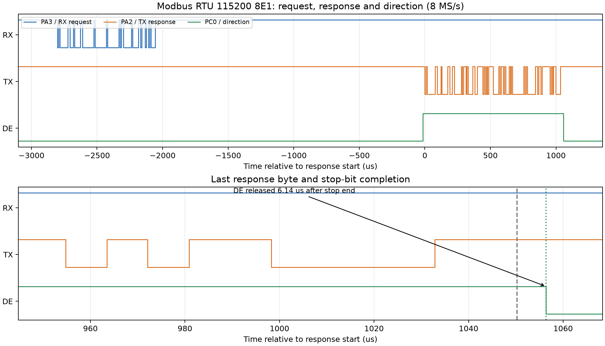
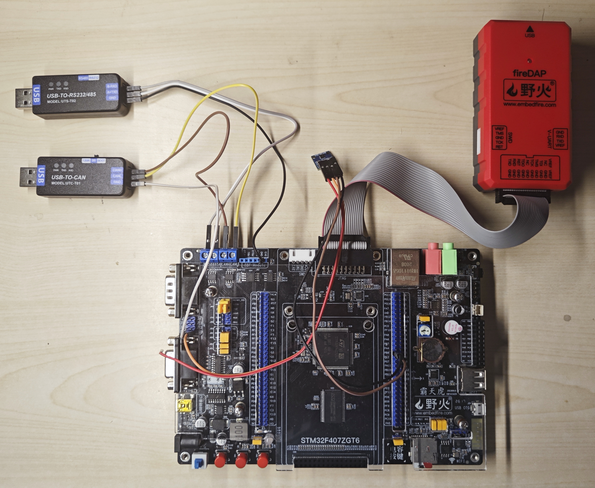
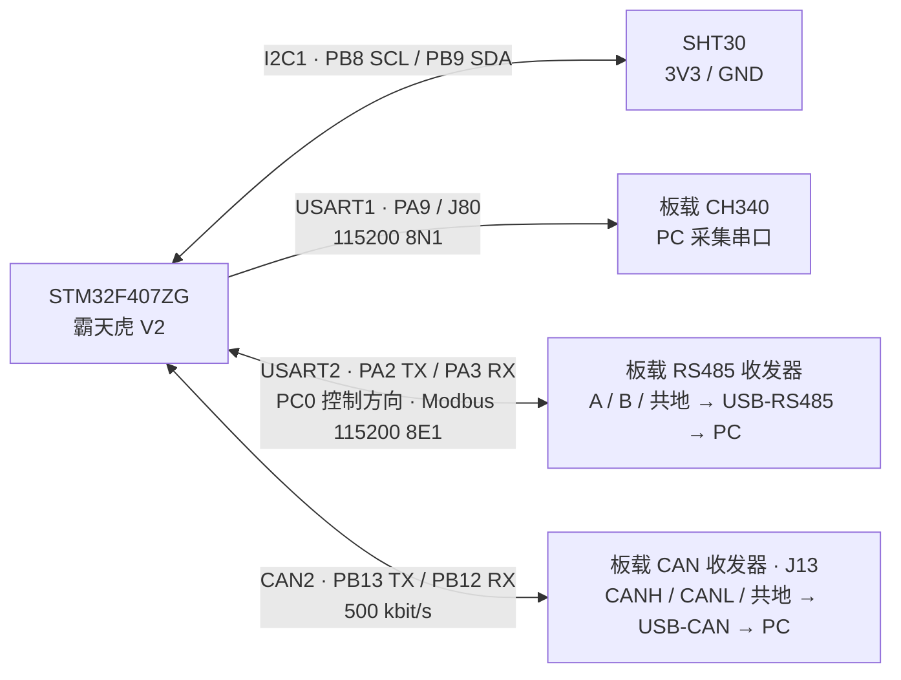
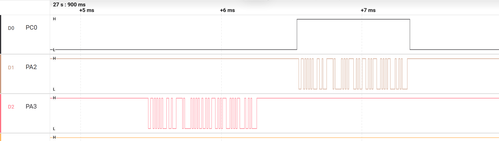
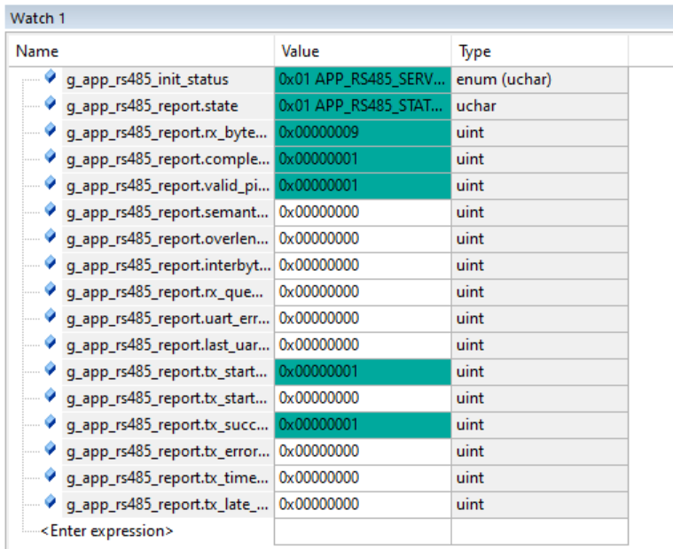

# STM32F407 数据采集终端 · Modbus RTU / RS485 / CAN / FreeRTOS

陶铭浩 · 2027届 · 嵌入式软件 / MCU固件方向

**从 SHT30 采集温湿度，通过 Modbus RTU、RS485、CAN 对外提供数据；用质量状态、Fault 现场与看门狗健康门控处理异常。**

`C` · `STM32 HAL` · `Cortex-M4` · `Modbus RTU` · `RS485 半双工` · `CAN` · `I2C` · `FreeRTOS` · `波形调试`

我负责RS485状态、超时与恢复规则设计，编写CAN请求校验、温湿度编码及环形队列入出队逻辑，完成实板联调；独立定位主循环与接收中断时间交错引发的无符号下溢故障。在FreeRTOS固件中，我选择最新值邮箱策略，编写采集、换算、发布与失败记录流程。

**运行演示：** 按[构建与接线](docs/BUILD.md)运行 `Tools/build_modbus_demo.ps1`，下载 Modbus＋诊断配置，再用通用主站读取温湿度与数据质量。[协议与实测](docs/MODBUS_RTU.md) · [个人贡献](docs/CONTRIBUTIONS.md) · [5页作品集](portfolio/project-portfolio.pdf)

## 我的主要工作

- **RS485状态与恢复设计：** 制定收发状态、超时及重同步规则，完成实板联调；115200 bit/s、10 Hz连续一小时取得**36000/36000次正确应答**。
- **CAN协议与队列实现：** 编写请求校验、温湿度字节编码及环形队列入出队逻辑，用PCAN和Keil核对通信链路；500 kbit/s下取得**1800/1800次正确应用应答**。
- **独立故障诊断：** 从“请求波形完整但无响应”出发，结合波形、调试计数及主循环/ISR时间推理，独立定位首字节误超时的无符号下溢根因，形成修复与回归闭环。
- **故障记录与健康门控：** 设计Fault记录校验与启动消费规则，结合CFSR、压栈PC和反汇编分析UsageFault；制定IWDG刷新、停喂与锁存条件，核对复位结果。
- **FreeRTOS任务数据交换：** 根据“显示最新温湿度”的需求选择单格覆盖邮箱，编写测量、换算、成功发布及失败记录流程，用序号、数据年龄和NACK恢复日志核对行为。
- **Modbus需求与硬件接入：** 确定通用主站读取温湿度与质量状态的目标，完成USB-RS485及逻辑分析仪接入；项目取得**600/600次正常读取**、采集故障恢复及三通道方向波形记录。

[设计决策与个人贡献](docs/CONTRIBUTIONS.md)提供实现入口和验证依据。

## Modbus RTU 实板成果（2026-11-15）

PC 主站 → USB-RS485 → STM32 → SHT30 数据快照。地址 **1**，**115200 8E1**，功能码 **0x04**；三个输入寄存器提供温度、湿度与质量状态。

| 验证内容 | 实测结果 |
| --- | --- |
| 正常连续读取 | **600/600 成功，0 通信错误**；10 Hz 设置，60.120 s |
| 异常请求与恢复 | **11 个边界/异常场景通过**，各场景后正常读取恢复 |
| 采集 NACK 与恢复 | **320/320 读取成功**；有效 → 陈旧 → 离线 → 有效，保留最近样本 |
| RS485 方向波形 | 8 MS/s、10 组事务；末停止位完成后 **6.02～6.14 μs** 释放方向 |
| Linux 网关兼容 | 5 s 暖机＋30 s 测试；29 条遥测、6 条诊断入库，29 条遥测获 MQTT 确认 |



D0=PA3 RX，D1=PA2 TX，D2=PC0 方向；80 个请求字节、110 个应答字节与 PC 收发记录逐字节一致。停止位末端由同次 UART 边沿拟合位宽计算，采样分辨率 0.125 μs。

[报文、故障恢复与波形证据](evidence/modbus/README.md) · [寄存器表与复现步骤](docs/MODBUS_RTU.md) · [源码及固件哈希核验](evidence/modbus/MANIFEST.json)

<!-- TEST_RESULTS_BEGIN -->
## RS485 / CAN 通信验证（2026-10-22）

| 日期 | 提交（测试基线） | 测试项目 | 规模 | 结果 | 日志 |
| --- | --- | --- | --- | --- | --- |
| 2026-10-22 | `9688122+dirty` | RS485 连续应答 | 1000轮PING/PONG | 通过：1000/1000 | [日志](docs/TestRecords/2026-10-22_communication_01/rs485_1000.md) |
| 2026-10-22 | `9688122+dirty` | RS485 一小时通信 | 10 Hz，3600.000571秒；前30分钟双总线并行 | 通过：36000/36000 | [日志](docs/TestRecords/2026-10-22_communication_01/rs485_1hour.md) |
| 2026-10-22 | `9688122+dirty` | CAN 周期请求 | 500 kbit/s、1 Hz、约30分钟；与RS485并行 | 通过：1800/1800应用应答 | [日志](docs/TestRecords/2026-10-22_communication_01/can_1800.md) |
| 2026-10-22 | `9688122+dirty` | 主机侧自动化检查 | Python 119项；生产C 477项断言；CAN 16个诊断场景及相关测试组 | 通过；BSP/HAL以替身隔离 | [日志](docs/TestRecords/2026-10-22_host_01/README.md) |

通信测试的PC超时、错误、跳过时隙均为0；前30分钟RS485与CAN双总线并行，同时保持温湿度采集上报。Python 119项由基础工具与模块83项、通信工具18项和FreeRTOS观察工具18项组成；生产C 477项断言引用同日主机执行记录。

源码与实测记录归档于 **`v1.0-bench`**。表中保留测试当天的提交状态，实测固件与标签内文件的对应关系见[版本映射](SNAPSHOT.md)。
<!-- TEST_RESULTS_END -->

## 硬件组成与接线



*硬件组成与接线实物*

STM32F407ZG开发板、SHT30、UTS-T02串口适配器、UTC-T01 CAN适配器与fireDAP调试器。各接口与引脚对应如下。



J40供电与RS485跳帽、引脚复用及CAN端接配置见[接线与运行说明](docs/BUILD.md#已记录的接线)。

## 实板波形与调试截图



RS485专项实测：红色PA3为接收，橙色PA2为发送；PC0控制收发方向，保持发送状态直到数据发完。结合此类波形与调试计数定位收发问题。[查看故障分析](docs/CASE_RS485.md)



上图为2026-09-04初始化修正后的单轮调试截图；2026-10-22的1000轮与一小时结果由上表中的逐轮日志记录。

## 系统怎样工作

```text
温湿度传感器 → 周期采集 → 最新数据 → 串口上报电脑
电脑发起请求 → Modbus RTU / RS485 / CAN → 校验请求 → 返回数据快照
程序运行监控 → 记录故障、判断运行状态 → 控制看门狗刷新

独立FreeRTOS固件：采集任务 → 单格邮箱保留最新值 → 上报任务
```

裸机终端与FreeRTOS采集目标分别编译、下载。裸机承担采集、双总线通信和故障诊断；FreeRTOS目标实现采集与上报任务的数据交换。

## 模块与源码入口

| 内容 | 入口 |
| --- | --- |
| 接线、编译下载、PC工具和测试命令 | [运行说明](docs/BUILD.md) |
| Modbus RTU 帧、CRC与异常响应 | [协议核心](Middlewares/Modbus/Src/mb_rtu.c) · [业务映射](Application/Src/app_modbus_registers.c) |
| RS485收发状态与时间判断 | [应用源码](Application/Src/app_rs485_service.c) |
| CAN请求校验与温湿度编码 | [协议源码](Application/Src/app_can_protocol.c) |
| CAN接收队列 | [队列源码](BSP/Src/bsp_can_rx_queue.c) |
| 异常记录与看门狗刷新条件 | [运行健康判断](Application/Src/app_watchdog_gate.c) |
| FreeRTOS采集与上报 | [任务源码](Experiments/FreeRTOS_Queue/Application/Src/app_queue_experiment.c) · [设计与实测](docs/RTOS.md) |
| 实板日志、波形和测试条件 | [验证证据](docs/EVIDENCE.md) |
| 具体职责与设计取舍 | [贡献说明](docs/CONTRIBUTIONS.md) |
| 项目作品集 | [5页PDF](portfolio/project-portfolio.pdf) |

## 工程组织与许可

初始化与中断入口放在Core，业务流程放在Application，器件驱动放在Components，板级适配放在BSP；Drivers保留ST官方库，Middlewares提供Modbus RTU协议核心与FreeRTOS内核，Tests/Tools提供主机侧检查与PC工具。

第三方代码与许可见[THIRD_PARTY.md](THIRD_PARTY.md)。自编部分尚未另行授予通用开源许可证，供求职展示与审阅。
