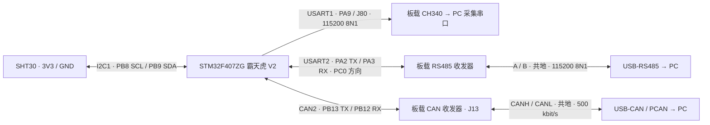
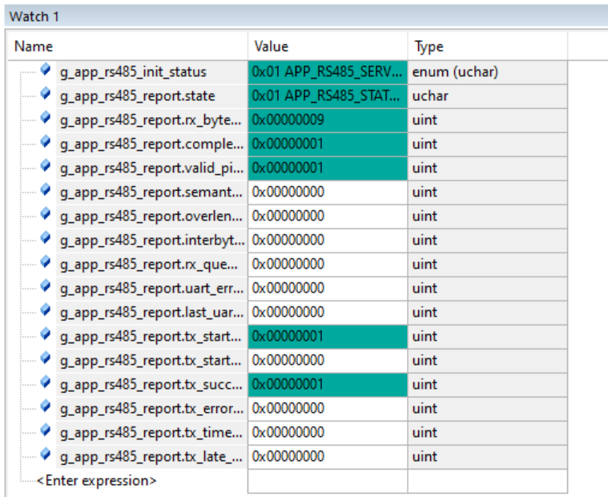

# STM32F407ZG 数据采集与通信终端

陶铭浩 · 2027届 · 嵌入式软件 / MCU固件方向

**一个STM32终端：采集温湿度，通过串口、RS485和CAN与电脑通信，并记录通信异常和程序故障。**

我负责通信规则、代表性核心逻辑、实板联调和故障定位；另以独立FreeRTOS固件实现“持续采集、只上报最新数据”的任务协作。

**怎么复现：**下载[`v1.0-bench`](https://github.com/tmhcyber/stm32f407-data-terminal/tree/v1.0-bench)，按[接线与运行说明](docs/BUILD.md)用Keil编译下载，再运行PC工具观察采样与请求应答。

## 我的主要工作

- **通信与联调：**制定RS485收发、超时和恢复规则，编写CAN请求校验、温湿度编码与队列核心逻辑。
- **独立故障定位：**结合波形和调试计数，发现主循环与接收中断的时间先后交错，定位无符号下溢导致的首字节误超时。
- **实时任务设计：**根据“显示最新温湿度”的需求选择单格覆盖邮箱，编写测量、换算和失败记录流程。

[设计决策与个人贡献](docs/CONTRIBUTIONS.md)提供实现入口和验证依据。

<!-- TEST_RESULTS_BEGIN -->
## 测试结果

| 日期 | 提交（测试基线） | 测试项目 | 规模 | 结果 | 日志链接 |
| --- | --- | --- | --- | --- | --- |
| 2026-10-22 | `9688122+dirty` | RS485 连续应答 | 1000轮PING/PONG | 通过：1000/1000 | [记录与日志](docs/TestRecords/2026-10-22_communication_01/rs485_1000.md) |
| 2026-10-22 | `9688122+dirty` | RS485 一小时通信 | 10 Hz，3600.000571秒；前30分钟双总线并行 | 通过：36000/36000 | [记录与日志](docs/TestRecords/2026-10-22_communication_01/rs485_1hour.md) |
| 2026-10-22 | `9688122+dirty` | CAN 周期请求 | 500 kbit/s、1 Hz、约30分钟；与RS485并行 | 通过：1800/1800应用应答 | [记录与日志](docs/TestRecords/2026-10-22_communication_01/can_1800.md) |
| 2026-10-22 | `9688122+dirty` | 主机侧自动化检查 | Python 119项；生产C 477项断言；CAN 16个诊断场景及相关测试组 | 通过；BSP/HAL以替身隔离 | [检查记录](docs/TestRecords/2026-10-22_host_01/README.md) |

通信测试的PC超时、错误、跳过时隙均为0；前30分钟RS485与CAN并行，同时保持温湿度采集上报。Python 119项由既有83项、通信工具18项和FreeRTOS观察工具18项组成；生产C 477项断言引用同日已执行记录。

源码与实测记录归档于 **`v1.0-bench`**。表中保留测试当天的提交状态，实测固件与标签内文件的对应关系见[版本映射](SNAPSHOT.md)。
<!-- TEST_RESULTS_END -->

## 硬件接线示意



接线前断电。J40供电与RS485跳帽、引脚复用、CAN端接要求见[接线表与运行说明](docs/BUILD.md#已记录的接线)；本图为连接关系示意。

## 实板波形与调试截图


RS485专项实测：红色PA3为接收，橙色PA2为发送；PC0控制收发方向，保持发送状态直到数据发完。结合此类波形与调试计数定位收发问题。[查看故障分析](docs/CASE_RS485.md)



上图为2026-09-04初始化修正后的单轮调试截图；2026-10-22的1000轮与一小时结果由上表中的逐轮日志记录。

## 系统怎样工作

```text
温湿度传感器 → 周期采集 → 最新数据 → 串口上报电脑
电脑发起请求 → RS485 / CAN → 校验请求 → 返回应答
程序运行监控 → 记录故障、判断运行状态 → 控制看门狗刷新

独立FreeRTOS固件：采集任务 → 单格邮箱保留最新值 → 上报任务
```

裸机终端与FreeRTOS实验分别编译、下载。裸机承担采集、双总线通信和故障诊断；FreeRTOS实验展示采集与上报任务的数据交换。

## 模块与源码入口

| 内容 | 入口 |
| --- | --- |
| 接线、编译下载、PC工具和测试命令 | [运行说明](docs/BUILD.md) |
| RS485收发状态与时间判断 | [应用源码](Application/Src/app_rs485_service.c) |
| CAN请求校验与温湿度编码 | [协议源码](Application/Src/app_can_protocol.c) |
| CAN接收队列 | [队列源码](BSP/Src/bsp_can_rx_queue.c) |
| 异常记录与看门狗刷新条件 | [运行健康判断](Application/Src/app_watchdog_gate.c) |
| FreeRTOS采集与上报 | [任务源码](Experiments/FreeRTOS_Queue/Application/Src/app_queue_experiment.c) · [设计与实测](docs/RTOS.md) |
| 实板日志、波形和测试条件 | [验证证据](docs/EVIDENCE.md) |
| 具体职责与设计取舍 | [贡献说明](docs/CONTRIBUTIONS.md) |
| 项目作品集 | [4页PDF](portfolio/project-portfolio.pdf) |

## 工程组织与许可

初始化与中断入口放在Core，业务流程放在Application，器件驱动放在Components，板级适配放在BSP；Drivers保留ST官方库，Middlewares提供独立实验使用的FreeRTOS内核，Tests/Tools提供主机侧检查与PC工具。

第三方代码与许可见[THIRD_PARTY.md](THIRD_PARTY.md)。自编部分尚未另行授予通用开源许可证，供求职展示与审阅。
