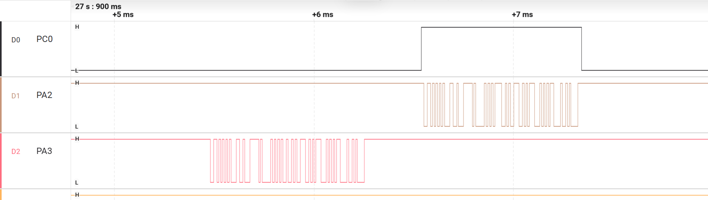

# RS485：完整PING无响应的时间下溢诊断

我在RS485实板联调中遇到“请求波形完整但PC超时”的故障，通过逻辑分析仪、Watch计数和主循环/ISR时间交错，独立推导出首字节被误判超时的根因。

配置：115200 8N1，自定义32字节CRLF帧，100ms字节间超时。

## 现象与定位路径

PC发出PING后超时；PA3可解码完整请求，PC0保持接收方向，PA2没有输出。Watch记录RX9、完整帧1、字节间超时1、语义无效1、有效PING0、UART错误0。

我先确认接收物理路径有数据，再根据方向信号和发送引脚判断故障发生在生成回复之前。完整帧却语义无效，说明需要检查进入成帧逻辑的字节内容和时间判定。

## 时间交错与根因

主循环先保存 `now_ms=1000`，随后ISR接收首字节并记录1001；消费时32位无符号 `1000-1001=4294967295`。原逻辑把这个差值解释为超过100ms，清掉首字节V；余下 `1|PING\r\n` 仍可形成CRLF帧，却无法匹配PING，与全部计数吻合。

[源码](../Application/Src/app_rs485_service.c)采用正向模差判定：先要求 `elapsed_ms < 0x80000000UL`，再比较100ms阈值，处理主循环旧时间快照与ISR新时间戳交错，同时保留Tick回绕语义。

## 回归与半双工方向

修复后取得精确PONG。正常响应的[方向波形](../evidence/rs485_tc.png)显示：PA3请求 → PC0拉高 → PA2响应 → 最后停止位完成后PC0拉低。

TC表示移位寄存器已完成最后停止位，TXE只表示数据寄存器空。9字节、115200 8N1的理论线时为0.78125ms，截图中方向高电平约0.80ms，二者相符。

## 验证结果

- 边界输入：精确PING、无效PANG、32字节完整帧、超长后重新同步、约50ms分段和约150ms半帧超时。
- 故障恢复：CPU暂停接收产生ORE（0x08）后，在同次启动中恢复PING应答并保留错误历史。
- 接线诊断：在当前开发板与USB-RS485组合上完成A/B对调故障及恢复，确认实际配对。
- 版本回归：[初始化修正版Watch](../evidence/rs485_final_watch.png)验证新启动应答；2026-10-22 HSE版进一步完成1000/1000连续轮次和一小时36000/36000通信。

[最新量化记录与完整日志](../Docs/TestRecords/2026-10-22_communication_01/RESULTS.md)提供周期、耗时与原始收发核验。此案例展示我将“现象→区分实验→时间推理→修复方案→回归”串成闭环的诊断方法。
