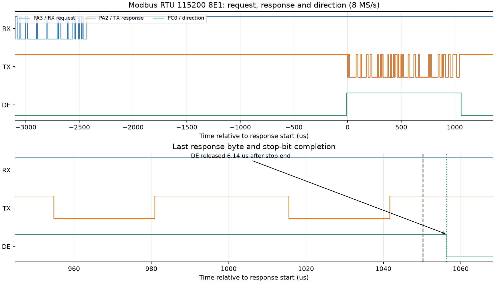

# FreeRTOS 四任务终端实板记录

2026-11-20 使用同一块 STM32F407ZG 与同一组接线对照裸机 Modbus＋诊断固件、FreeRTOS 四任务固件。Modbus 采用 115200 8E1、100 ms 请求间隔，CAN 采用 500 kbit/s、约 1 Hz。各窗口先暖机 5 秒，再并行验证两个总线和 USART1 上报。

## 同负载对照

| 实测项 | 裸机 | FreeRTOS |
| --- | ---: | ---: |
| USART1 正常观察窗 | 61.526 s | 61.514 s |
| Modbus 有效应答 | 600/600 | 600/600 |
| CAN 有效应答 | 60/60 | 60/60 |
| 遥测 / 诊断 | 61 / 13 | 61 / 12 |
| Modbus PC RTT p50 / p95 | 6.14 / 7.13 ms | 6.80 / 7.90 ms |
| CAN PC RTT p50 / p95 | 2.41 / 3.21 ms | 2.32 / 2.97 ms |
| MCU 采样间隔 | 1000 ms（60 个间隔） | 1000 ms（60 个间隔） |
| ROM / RAM（MAP，字节） | 31,092 / 5,244 | 38,640 / 38,604 |

PC RTT 从提交请求计至确认有效响应，覆盖 USB、主机调度和解析。RTOS 板上计数记录 Modbus 600 次完成、CAN 60 次成功发送，收发错误、CAN 队列丢弃和快照错误均为 0。通信、采集、上报、监控的最大任务完成间隔分别为 4、4、6、12 ms。最小栈余量分别为 624、413、839、424 word，内核堆最小余量为 20,504 字节。 [裸机日志](bare-metal/) · [RTOS 日志与板端计数](rtos/)

## 异常恢复与方向时序

- 将 SHT30 运行时地址从 `0x44` 改为 `0x45` 再恢复。320/320 次 Modbus 读取成功，包含 20 次陈旧状态、108 次离线状态。陈旧和离线期间保留最近温湿度，地址恢复后继续更新有效样本。 [读取记录](sensor-fault-readings.jsonl) · [板端状态](sensor-fault.json)
- 11 个 Modbus 读取边界和异常场景符合预期，每组之后的正常请求均恢复。三通道 8 MS/s 实测包含 10 组事务，解码得到的 80 个请求字节和 110 个应答字节与 PC 日志逐字节一致。由同次 UART 边沿拟合位宽，测得 PC0 在末停止位完成后约 6.02–6.14 µs 释放。 [报文用例](modbus-cases.json) · [波形结果](waveform/timing-analysis.json)
- 分别暂停通信、采集和上报任务，SWD 记录对应停滞位、门控 HOLD 和停止更新的 IWDG 刷新计数。三次自然复位均从 Flash 重新运行，观测到重启用时 2.00–2.13 秒。基本与浮点扩展 PSP 场景分别记录 `0xFFFFFFFD` 和 `0xFFFFFFED`，两个场景的压栈 PC 均指向实际故障指令，重启后 `d=1` 上报匹配的现场和复位原因。 [门控、复位与 Fault 记录](watchdog-and-fault.json)
- Linux 网关在独立 30 秒窗口接收 29 条遥测与 6 条诊断，全部入库。29 条遥测获 MQTT 确认，IPC 和 MQTT 的诊断字段与接收记录匹配。 [网关核对结果](gateway.json)



## 构建与版本

公开源码使用 Keil ARMCC 5.06u7 全量构建，RTOS 目标及两种裸机通信配置均为 0 错误、0 警告。RTOS 重建 HEX 与实板下载校验的 HEX 逐字节一致。编译依赖及公开证据对应哈希见[发布清单](MANIFEST.json)。 [已验 HEX](IndustrialTerminal_RTOS.hex) · [构建与演示](../../docs/BUILD.md#freertos-四任务终端)

```powershell
python Tools/check_freertos_publication.py
```
