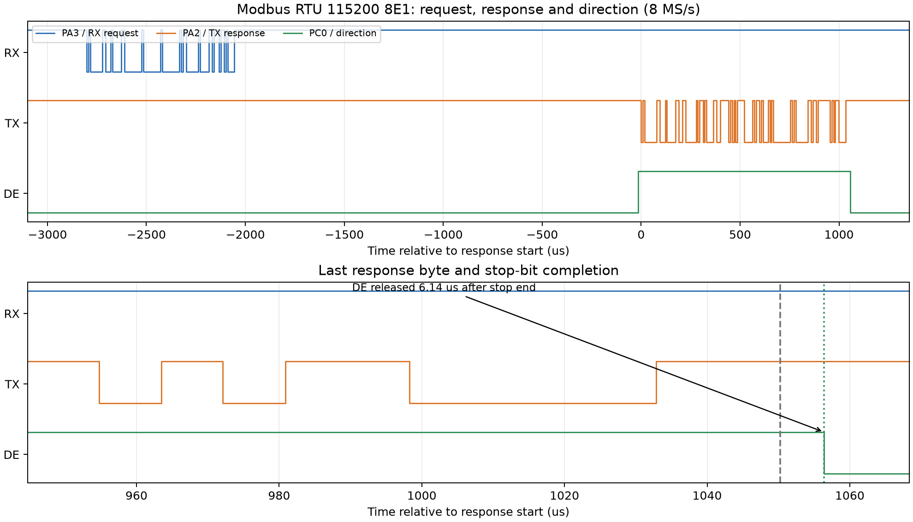

# Modbus RTU 实板验证 · 2026-11-15

野火STM32F407ZG霸天虎V2＋SHT30＋CH343 USB-RS485，地址1，115200 8E1，0x04读取。固件启用Modbus与USART1诊断；ARMCC 5.06 update7 build960全量构建0错误、0警告，Code/RO/RW/ZI为30120/788/184/5060 B，Flash读回31092字节一致。

## 连续读取与故障恢复

| 项目 | 条件与结果 | 原始记录 |
| --- | --- | --- |
| 正常读取 | 600/600，0通信错误；10 Hz设置，60.120 s | [收发](normal-600/packets.jsonl) · [逐轮](normal-600/readings.jsonl) · [汇总](normal-600/summary.json) |
| 往返时间 | 中位 5.834 ms，P95 6.749 ms，最大 33.430 ms（PC 端到端往返） | [统计](normal-analysis.json) |
| 请求边界与异常 | 11场景通过；各场景后正常读取恢复 | [请求/应答](request-cases.json) |
| 采集异常与恢复 | 320/320读取成功；192有效、20陈旧、108离线 | [收发](address-fault/packets.jsonl) · [逐轮](address-fault/readings.jsonl) · [汇总](address-fault/summary.json) |

请求覆盖合法子区间、不支持功能、地址越界/65535防回绕、数量0/126、其他从站地址、广播、坏CRC、截断和257字节过长输入。功能/地址/数量错误分别返回01/02/03异常；其他地址、广播和损坏帧保持静默（观察窗200 ms）。

采集故障使用可恢复RAM地址注入 **0x44→0x45→0x44**，触发真实I2C NACK。注入后观察到有效→陈旧→离线→有效；陈旧/离线期间保留30.12 ℃、41.29 %RH最近样本。21次NACK、恢复计数1。[状态变化](fault-analysis.json)与[调试快照](address-fault-debug.json)记录具体过程。

## 三通道波形



Saleae Logic，8 MS/s，3 s；D0=PA3 RX、D1=PA2 TX、D2=PC0方向。10组事务中80个请求字节、110个应答字节与PC包记录完全一致，UART起始/奇偶/停止位检查通过。

| 测量 | 结果 |
| --- | --- |
| DE提前发送 | 6.50～14.75 μs |
| 末停止位完成至DE释放 | 6.02～6.14 μs |
| 请求结束至应答开始静默 | 1975.84～2047.97 μs |
| 采样分辨率 | 0.125 μs |

停止位端点采用同次采集中 UART 边沿拟合位宽计算。[原始SAL](waveform/modbus-3ch.sal) · [边沿CSV](waveform/digital.csv) · [逐组分析](waveform/timing-analysis.json) · [PC包](waveform/serial/packets.jsonl)。分析脚本为 `Tools/analyze_modbus_waveform.py`。

## Linux网关与版本

新MCU固件经CH340→VirtualBox UART2→Linux ttyS1，以固定网关二进制单列5 s暖机后完成30 s窗口：29遥测与6诊断全部入库，29遥测获MQTT PUBACK、0覆盖；26个IPC诊断快照和7个MQTT诊断状态匹配。[完整结果摘要](linux-compatible-result.json)。

[固件包](verified-firmware.zip)保存原AXF/HEX/MAP与演示配置。AXF SHA256：

```text
22f4f056c90799eec6e02c028cb14a21d2ae47219588528bb80aa10a486adeda
```

[MANIFEST.json](MANIFEST.json)绑定 `v1.1-modbus` 的生产源码、工具与证据哈希。[PROVENANCE.json](PROVENANCE.json)记录原始证据与公开副本映射。执行 `python Tools/check_modbus_publication.py` 核验这组实板记录。 [构建说明](../../docs/BUILD.md)

公开源码复验：PING/PONG与Modbus两种模式均全量构建0错误、0警告；Modbus重建HEX与实板归档逐字节一致，AXF可装载程序段一致。生产C、BSP、诊断开关与PyModbus互通检查通过，见[复验记录](PUBLICATION_CHECK.json)。
